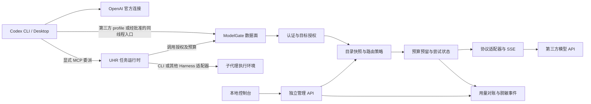

# ModelGate 总体架构提案

日期 2026-11-11（Asia/Shanghai）。本文件描述目标设计。实现状态见[独立审计](audit.md)，进入条件见[开发总计划](roadmap.md)。

## 产品定位

ModelGate 是本地推理数据面与运维控制台。它提供身份隔离的接入、协议适配、可验证模型目录、有限次数的路由恢复、预算与用量对账。Codex 保持其原生线程、工具、审批和上下文管理。UHR 管理跨 Harness 的任务和执行生命周期。独立安装 ModelGate 可运行推理网关。部署 UHR 后可选用该网关及 Codex MCP 入口。

| 边界 | 所有权与数据流 |
| --- | --- |
| 官方连接 | 默认由 Codex 直接访问官方。单线程聚合实验需要专门批准的本地入口和明确的最终官方目标，且每次发送都校验 scheme、host、port、path、credential mode。API Key 计费与 ChatGPT 计划分别处理。官方身份、密文历史和订阅额度留在授权域。 |
| 第三方连接 | 接入层解析调用主体与模型授权，按供应商固定出站头和模型绑定，给需要会话关联的目标发按供应商隔离的会话标识。独立发放和吊销调用 Key。第三方模型使用其自身 API 凭据。 |
| 目录 | 发布不可变 generation，目录、路由、客户端加载和回滚指向同一快照。官方目录按客户端版本保留原字段及隐藏项，第三方目录按已声明且验证的能力生成。slug 使用不可变 ID 与显式别名，删除保留墓碑。未知 slug 停止，未知能力保守标记。 |
| 请求状态 | 路由由一个执行器消费决策目标。阶段包含未发送、发送状态未知、已受理、已交付、可能有副作用、部分提交和终止。阶段和预算跨适配器一致。上游无法证明支持续流时，发送后以终止事件交还客户端。 |
| 费用 | 单次、任务、日预算用独立账本。发送前原子预留，带 attempt ID 对账，失败分明确未执行与未知已扣费。未知成本可拒绝，未知用量保留待对账。token 统计、估算 USD、已核实费用及订阅余量有各自来源和时效。 |
| 控制面 | 管理 API 只读状态、校验配置事务、提供脱敏差异与回滚。UI 展示真实 API 结果、陈旧和 UNKNOWN，生成客户端导出包。Codex 机器配置优先由用户控制的本地工具确认，历史优先诊断和导出。 |
| UHR | UHR 拥有 task/run/parent ID、依赖、工作区和工具权限、执行者、审批、取消、重试与验收。ModelGate 只拥有 inference request/attempt ID、路由和费用。UHR 传引用及受限预算，接收用量和终态。网关无权执行 shell 或写仓库。 |

建议将 UHR 对网关的调用契约定义为 `mg.inference/1`。调用携带已授权任务引用、请求 ID、候选供应商范围、能力约束、截止时间及币种/预算上限。网关响应给出选定模型、候选排除原因、尝试 ID、交付状态、已确认用量和待对账量。工具授权随 UHR 任务租约下发，模型输出中的指令不能修改它。调用方重试须复用请求 ID，网关按作用域和内容摘要识别重复。重连由客户端按已明确提交状态处理。首版所有状态和账本由单写者管理，待实测出现多进程需求再评估事务后端。

## Codex v1、v2 与可维护委派路径

目标客户端源码为 [Codex 0.167.0](https://github.com/openai/codex/tree/086ccc833bc9cf01024ad2dd6af7dbd421b6bf9a)。该版本协议的 `AgentMessage` 有可选 item ID、author、recipient 和 content 数组。数组可含文本或密文。客户端的纯文本提取在出现任何密文时即失败。子线程 ID 标识运行实例，代理角色/路径标识成员，tool call ID 关联调用与回执，任务标识应作为独立不透明值保存。把其中任意一个当成其他 ID 会破坏并行、续接和回执归属。 [Codex 协议源码](https://github.com/openai/codex/blob/086ccc833bc9cf01024ad2dd6af7dbd421b6bf9a/codex-rs/protocol/src/models.rs#L947-L965) · [v2 spawn 源码](https://github.com/openai/codex/blob/086ccc833bc9cf01024ad2dd6af7dbd421b6bf9a/codex-rs/core/src/tools/handlers/multi_agents_v2/spawn.rs)

Codex v1 的客户端协作处理明文输入、分配子线程并管理工具结果。v2 有独立的消息及调度处理，支持面向代理的消息传递，并保留不透明任务材料。历史实验中关闭 v2 的单次 exec 没有观测到 v1 工具可用。TUI、其他构建及 flags 下的行为仍为 UNKNOWN。Codex 的子代理自定义可选模型，官方配置文档说明单个代理配置不能覆盖父会话的 `model_provider`。 [v1 spawn 源码](https://github.com/openai/codex/blob/086ccc833bc9cf01024ad2dd6af7dbd421b6bf9a/codex-rs/core/src/tools/handlers/multi_agents/spawn.rs) · [Codex 子代理配置](https://learn.chatgpt.com/docs/agent-configuration/subagents)

固定版本的 v2 客户端实现也有条件明文分支。spawn 读取 message、task_name、model、reasoning_effort 和 fork_turns，将工具来源传给消息包装器。包装器对 DirectPlaintextMessage 和 CodeMode 产生明文，其余走不透明任务通路。它是客户端受控来源判断。ModelGate 从网络收到加密 item 时无权改变来源或恢复正文。本轮未建立官方 GPT 经普通原生 spawn 将明文交给第三方的稳定支持契约，客户端明文分支和跨供应商闭环列为独立研究。父线程、父轮次和根轮次由客户端创建和关联，换模型不改变这层所有权。 [v2 参数与父子事件](https://github.com/openai/codex/blob/086ccc833bc9cf01024ad2dd6af7dbd421b6bf9a/codex-rs/core/src/tools/handlers/multi_agents_v2/spawn.rs#L105-L208) · [线程派生](https://github.com/openai/codex/blob/086ccc833bc9cf01024ad2dd6af7dbd421b6bf9a/codex-rs/core/src/thread_spawn.rs#L159-L205) · [消息来源分支](https://github.com/openai/codex/blob/086ccc833bc9cf01024ad2dd6af7dbd421b6bf9a/codex-rs/core/src/tools/handlers/multi_agents_v2.rs#L54-L67)

公开的 Responses 多代理 API 还定义 hosted `multi_agent_call`、`multi_agent_call_output` 和加密 `agent_message`。服务端执行 hosted action，以 `call_id` 对应结果，以 agent/author/recipient 归属事件。客户端自定义 function tool 走普通工具往返。这个公开 API 可用于官方原生能力验证，文档未给出可将现有加密任务交给任意第三方 Chat 模型的接口。ModelGate 现有历史样例在子线程收到了加密任务，桥接返回 `v2_encrypted_task_unsupported`。继续维护此拒绝边界并覆盖全部实际字段形态。 [Responses 多代理指南](https://developers.openai.com/api/docs/guides/responses-multi-agent) · [历史失败证据](https://github.com/xiaomengxizzh/model-gate/blob/64a5c96df8ec6445371150fb21414b98aed1bac3/docs/evidence/2026-11-11-e4-v2-live-blocked.md)

| 维度 | A 原生 v2 兼容 | B 显式委派，通过 UHR 执行 |
| --- | --- | --- |
| 实现与稳定性 | 官方原生透传价值高。第三方须有书面受支持协议、目标理解不透明材料且端到端通过，当前不可验收。 | 用本地 MCP 显式传受控任务摘要。首版限一次异步只读任务，能独立在 mock 验证。 |
| Codex 版本耦合 | 依赖客户端 build、身份、目录、事件 schema 与上游能力。 | 依赖公开 MCP 工具接口与版本化 UHR 任务契约。App Server 可用于另建集成端，Desktop GUI 自身单独验收。 |
| 工具与上下文 | 官方域可保留原生历史和工具。第三方 Chat 有明确转换损失。 | Codex 保留自身上下文。工作者只收显式任务、授权引用、工具许可，结果经 MCP 回到原线程。 |
| 成本与权限 | 每次真实验证须单列官方计划和第三方成本，订阅不作为公共备用池。 | UHR 接入审批、请求额度和运行取消，ModelGate 约束每笔尝试，费用可回查至任务。 |
| 维护与故障 | 维护一个有版本支持矩阵的原生通道，出现缺口按客户端能力降级或停止。 | 使用 UHR 既有调度和隔离。任务失败回结构化状态，权限、工作区和签收统一处理。 |

采用双轨。短期优先 A 的官方保真与第三方边界，长期跨供应商协作走 B。B 建议提供 `delegate_task`、`get_task_result`、`cancel_task`，输入受限摘要、任务引用、预算及读写意图，返回任务标识、状态、已脱敏结果与证据引用。工具端只转发本机作用域凭证，信任身份来自连接而非模型生成字段。UHR 未就绪时显示不可用，首轮用 mock UHR 服务验证握手和回执。A 的跨供应商原生 v2 保留研究门槛，只有上游公开支持、零凭据跨域和工具回执/恢复通过时重新立项。明文委派由主代理显式发起。 [Codex MCP](https://learn.chatgpt.com/docs/extend/mcp?surface=cli) · [Codex App Server](https://learn.chatgpt.com/docs/app-server)

## 订阅与客户端发布边界

OpenAI 文档支持 `openai_base_url` 覆盖内置 OpenAI 推理地址，支持本地目录启动加载。App Server 文档约束线程 provider 与存档身份一致。当前双向切换实验保持客户端 `openai` 身份，在网关内部选实际目标。配置功能本身不授予订阅凭据转发权。发布前核对适用个人或组织条款、连接场景、账号归属、数据域及 OpenAI 支持的接入条件。SIWC（Sign in with ChatGPT）有适用范围与明确限制，第三方泛用代理不能从 SIWC 条款推导授权。订阅额度用尽后默认停止，另一个计费身份需要用户明示选择。 [Codex 配置](https://learn.chatgpt.com/docs/config-file/config-reference) · [OpenAI 使用条款](https://openai.com/policies/terms-of-use/) · [SIWC 条款](https://openai.com/policies/sign-in-with-chatgpt-terms/)

## 产品化顺序

管理台依次交付供应商状态、能力来源和连接诊断，路由与用量解释，配置差异与回滚，客户端导出和只读会话诊断。费用页按授权和实际用量来源标记数据。UHR 的任务管理页可链接到推理事件摘要。Desktop 的选择器、同线程切换、撤销配置、工具/断流和多代理使用专门验收矩阵。现有旧 UI 在新台达到主要操作等价且可回滚时再退役。

UHR 当前边界以本机 `b3eaf0e26011a8ae928b47691d32f4e610f2df9a` 的活跃开发工作树为依据。可见 `apps/daemon/src/commands/command-bus.ts`、`runtime/dispatch/result-reconcile.ts` 和预算预留迁移。交接仍标注父 102 与 105 RUNNING、`product_runtime=false`，因此 UHR 集成入口是路线图依赖。 [UHR 当前交接](https://github.com/xiaomengxizzh/xiaomengwork/blob/b3eaf0e26011a8ae928b47691d32f4e610f2df9a/docs/progress/handoff-20261108-sol-luna-cli.md)
