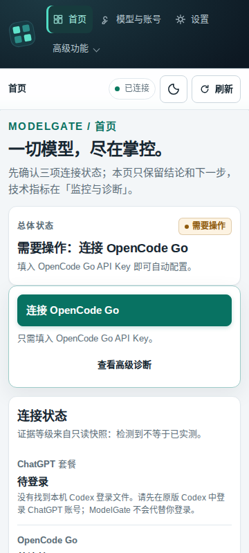
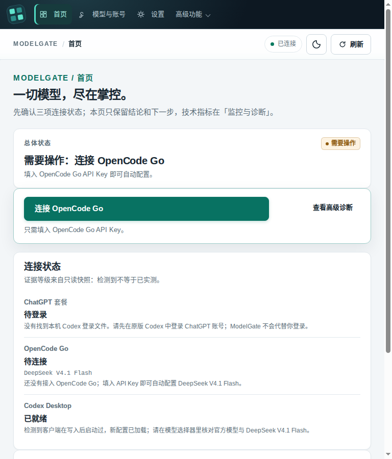
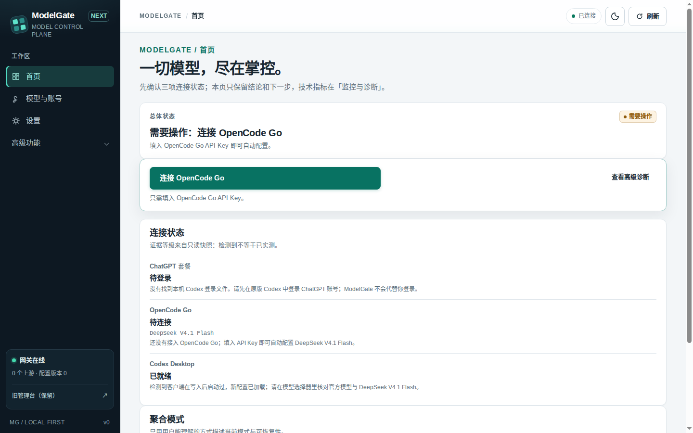

# 前端体验 V3｜开发交付报告（2026-11-15）

> 分支：`feat/modelgate-ux-v3` → **最终 HEAD `78cef49`**（被测产品 SHA `767866d`；从 `origin/mg-codex-native@708cf5e803fed27517caf8639af1bebb28401e04` 新建；**未合并 main、未发版、未把 PR #7 转 Ready**）
> 计划：[前端体验 V3 执行计划](2026-11-15-frontend-experience-v3-execution-plan.md) · 契约：[产品状态投影与模块契约](../contracts/ui-v3-product-status.md) · 基线：[UX-00 基线](2026-11-15-ux-v3-ux00-baseline.md) · 独立验收：[A5 验收记录](../evidence/2026-11-15-ux-v3-a5-acceptance.md)
> 组织方式：主代理集成 + 5 个专职子代理（A1 首页/IA、A2 Go 向导/聚合、A3 状态层、A4 设计/无障碍、A5 独立 QA），每人独立工作树与写集；共享入口（`src/index.js`、`scripts/test/run.mjs`、`ui-next.test.mjs`、`app.js` 集成）由主代理落地。

## 1. 修改的代码与模块清单

### 新增

| 文件 | 作用 |
| --- | --- |
| `src/ui-next/js/product-status.js` | `mg-ui-product-status/1` 纯函数投影：状态机、证据等级、唯一主 CTA、错误来源区分（`statusError`/`aggregationError`）、`matchesGoTargetId()` 容错匹配已发布公共 ID |
| `src/ui-next/js/views/connections.js` | 单页引导：key → model → enable（428 预览 → 一次确认 → consent → 回执）→ restart → use → revert；高级设置折叠；部分失败如实 |
| `scripts/test/offline/ui-product-status.test.mjs` | 20 例：状态机/证据等级/404/429/409/过期登录/探测不可判定/目标模型 ID 容错 |
| `scripts/test/offline/ui-v3-home.test.mjs` | 10 例：10 状态唯一 CTA、无伪成功、三条状态行、导航/深链、静态职责 |
| `scripts/test/offline/ui-v3-connections.test.mjs` | 18 例：编排顺序、部分失败、428/409/422、Key 不回显、preset HTTP 契约 |
| `scripts/test/offline/ui-v3-state.test.mjs` | 12 例：epoch/abort/并发合并、401/403/409/断网、freshness、鉴权前置零请求、草稿保护 |
| `scripts/test/offline/ui-v3-visual.test.mjs` | 11 例：设计令牌/断点/焦点/动效、`statusRow/primaryAction/formField/stepper` 行为与 ARIA |
| `scripts/test/offline/ui-v3-acceptance.test.mjs` | 10 例：独立黑箱 UI-01/02/03/05/08/10/11/13/15（+UI-16 BLOCKED） |
| `scripts/e2e/ui-v3-browser.mjs` | 零依赖 CDP 浏览器验收（复用本机 Chrome，不下载），11 项断言 + 三视口截图 |
| `docs/contracts/ui-v3-product-status.md` | 状态机/证据等级/接口来源/路由与状态层契约/写集/错误矩阵 |

### 修改

| 文件 | 变更 |
| --- | --- |
| `src/ui-next/index.html` | 主导航分层：主分区（首页/模型与账号/设置）+ 默认收起的高级功能（5 项）；保留 app.js 依赖的全部 id；无内联脚本/外链 |
| `src/ui-next/js/router.js` | ROUTES 增加 `group/navLabel/order/icon`；新增 `connections`；`routeFromHash` 忽略查询串；`routesByGroup`/`routeMeta`/`navigate(id,{step})`；7 个旧 id 全保留 |
| `src/ui-next/js/views/dashboard.js` | 改为状态驱动首页：总体结论 → 唯一主 CTA → 三条连接状态 → 聚合摘要 → 高级诊断入口；技术指标迁至 `#/observability` |
| `src/ui-next/js/views/aggregation.js` | 删除 V1 Console 全量话术；默认 Go preset + DeepSeek V4.1 Flash；技术长表收进"高级详情"；9 个既有导出与深链保留 |
| `src/ui-next/js/store.js` | 共享快照 + `productStatus()` 缓存 + `refreshProduct`（epoch/abort/合并）+ `invalidateProductStatus`/`onProductStatus`/`setProductPhase`（含 `preview_pending`）+ `aggregationState()` + `shouldRefresh` + 鉴权前置门 |
| `src/ui-next/js/api.js` | 聚合 9 个方法；`request` 支持 `opts.signal`（取消非 401）；401/403 语义不变 |
| `src/ui-next/app.js` | 路由按需刷新、可见+freshness 静默只读轮询、弹窗/草稿不重建、启停后强制失效（函数 + `mg:aggregation-changed`）、注册 `connections`、401 清屏前 `closeDialog()` |
| `src/ui-next/styles.css` | 重写为令牌化设计系统：明暗主题、15px/12px 字号、≥40px 按钮（CTA 44px）、`:focus-visible`、reduced-motion、360/768/1440 断点、卡片层级、危险动作 |
| `src/ui-next/js/components.js` | 19 个既有导出保留；新增 `statusRow/primaryAction/stepper/formField/statusLevel/closeDialog`；dialog 补 Escape/焦点圈定/归还；table/kvList/tabs 补语义与键盘 |
| `src/index.js` | `GET /api/status` 新增只读 `official` 投影（见 §4） |
| `src/aggregation/api.js` | `normalizeProviderInput` 透传 `preset` 并导出（唯一后端行为改动） |
| `scripts/test/run.mjs` | 登记 6 个新套件（清单 125） |
| `scripts/test/offline/ui-next.test.mjs` | 静态资产清单加入 `product-status.js` 与 `views/connections.js` |
| `CHANGELOG.md` / `docs/README.md` / `docs/development-plan.md` / `docs/contracts/management-api-v1.md` / `docs/contracts/ui-next-api-matrix.md` | 同步行为、契约、索引与阶段状态 |

## 2. UX 阶段完成状态

| 阶段 | 内容 | 状态 |
| --- | --- | --- |
| UX-00 | 代码审计、状态机、接口来源、错误矩阵、证据等级、可复现基线 | **完成**（20 例契约测试；基线 119/1135 绿 → 现状 125/1216 绿） |
| UX-01 | 首页与分层导航 | **完成**（离线 10 例 + 浏览器 UI-01 全项 PASS） |
| UX-02 | OpenCode Go 单字段向导 | **完成**（18 例；真实 Key 写入通道 HTTP 实测 201/400/409） |
| UX-03 | 聚合启停完整引导 | **完成（离线/契约层）**：428 预览、一次确认、consent+expectedSha、409 三方差异不覆盖、退出恢复；**真实原子写链 BLOCKED**（隔离实例无已发布聚合目录，实测 422） |
| UX-04 | 全局状态同步与高级功能归位 | **完成**（12 例；浏览器页面错误 0 条） |
| UX-05 | 视觉系统与可访问性 | **完成（规则+浏览器断言）**：三视口首屏 CTA 可见、高级分组像素级收起；真实读屏器/axe 未跑 |
| UX-06 | 整体验收、回归、文档与交接 | **完成**：独立黑箱 + 浏览器证据 + 反降级审查 + 本报告；真实模型项 BLOCKED |

## 3. 子代理实现与验收证据

| 子代理 | 分支 | 关键交付 | 自证 | 独立复核 |
| --- | --- | --- | --- | --- |
| A1 | `feat/ux-v3-a1-home` | 分层导航、状态驱动首页、唯一 CTA、窄屏首屏 CTA、证据徽章去歧义、模型名不截断 | `ui-v3-home` 10/10、`check` 19/19 | A5 浏览器 UI-01/UI-15 全 PASS |
| A2 | `feat/ux-v3-a2-go` | `connections.js` 单页向导、`aggregation.js` 高级归位、`preset` 透传 | `ui-v3-connections` 18/18、既有 agg-ui 10/10、HTTP 契约实测 | A5 黑箱 UI-03/UI-05 PASS |
| A3 | `feat/ux-v3-a3-state` | 共享快照、epoch/abort、freshness、鉴权前置（消除 401/403 噪声） | `ui-v3-state` 12/12 | A5 浏览器 UI-13 由 FAIL→PASS（同一脚本对照） |
| A4 | `feat/ux-v3-a4-design` | 令牌化样式、A11y 组件、三视口 | `ui-v3-visual` 11/11 | A5 浏览器像素级收起/焦点断言 |
| A5 | `feat/ux-v3-a5-qa` | 黑箱验收、CDP 浏览器脚本、UX-00 审查 F-1..F-10、反降级结论 | 见其 evidence 文档 | 独立于实现方；发现 1 个 P0（`GO_TARGET_MODEL_ID` 未定义）+ 9 项状态诚实性缺陷，全部修复或书面 WONTFIX |

**A5 发现的真实缺陷与处置**：F-1（P0 ReferenceError，真实 Go 流量时首页崩溃）→ 已修；F-2~F-8、F-10 → 已修（unknown≠未安装、探测不可判定=unknown、过期登录可见、429 保留 Retry-After、428 可达、模式未知不提示启用、原生压缩未证明显式说明）；F-9（`restart.needed` 缺失）→ 复核 `computeRestartState` 全分支恒带布尔值，真实 API 不可达，**WONTFIX 并在契约注明**。

## 4. 前后端接口变动与兼容

| 变动 | 类型 | 兼容性 |
| --- | --- | --- |
| `GET /api/status` 新增 `official:{credential,expiry,reason,authMode,level,source,checkedAt}` | **新增只读字段** | 向后兼容（旧字段不变）；取值 `detected/missing/unknown` + `valid/expired/unknown`；**永不返回 token/account** |
| `POST /api/aggregation/providers` 透传 `preset` | 新增可选入参 | 向后兼容（不传 `preset` 行为不变）；内联 `apiKey` 仍被 registry 拒绝 |
| 管理 API 路径/鉴权/状态码 | 未变 | `explicitAdmin` + loopback 判定、401/403/409/422/428 语义保持 |
| 前端路由 | 新增 `#/connections` | 7 个旧 hash 路由、`#/aggregation` 深链、`/` 与 `/admin` 旧控制台全部保留 |
| 前端组件导出 | 新增 6 个 | 19 个既有导出名与签名不变（其余视图不回归） |
| Codex 原生能力（compaction/Agent Team/tool 声明） | **未改动** | 未触碰 `src/codex/interop.js`、未新增压缩器；前端只展示真实状态 |

## 5. 真实截图（本机 Chrome 153，隔离网关 + 虚构令牌，零真实模型请求）

| 视口 | 截图 |
| --- | --- |
| 360×800 |  |
| 768×900 |  |
| 1440×900 |  |

（`-r3` 为 A5 在最终被测 SHA 上独立复跑的正式证据；`-final` 为主代理同 SHA 前一轮；基线图与 `-integrated` 对比图保留。）

基线（修复前）与 `-integrated` 对比图保留在 `docs/evidence/screenshots/`，可用于复核首屏 CTA 与徽章修复。

## 6. 自动化测试、浏览器测试与回归

| 命令 | 结果 |
| --- | --- |
| `npm run check` | PASS：UI modules 19/19 syntax OK |
| `npm test` | **PASS：125 套件 / 1217 用例 / 0 失败 / 3 用例 skip**（82.5s；A5 在被测 SHA `767866d` 独立复跑，主代理同 SHA 复跑一致） |
| `npm run docs:check` | PASS |
| `npm run contract:check` | PASS |
| `node --test scripts/test/offline/ui-v3-acceptance.test.mjs` | **10 pass / 0 fail / 1 skip**（UI-16 无付费授权；含 `preview_pending` 状态层→投影断言） |
| `node scripts/e2e/ui-v3-browser.mjs` | **11/11 PASS**（真实 Chrome 153，A5 独立复跑 `--suffix -r4`，未复用 Lead 截图）：加载/三条状态行/唯一 CTA/高级分组像素级收起/运行时 aria-current 三段/无伪成功/无凭据持久化/三视口首屏可见/页面错误 0 |
| 受影响既有套件 | `ui-next`、`ui-state`、`ui-contract`、`agg-desktop-ui`、`agg-v2-desktop-ui`、`agg-runtime-reload`、`admin-projection` 等全绿 |

**验证口径**：离线断言 = 代码级/契约级；浏览器断言 = 真实 Chrome 渲染（网关为隔离实例 + mock 上游）；**真实 Go/GPT 推理与真实 Desktop 交互未执行**（无付费授权），一律 BLOCKED。

## 7. 尚未关闭的问题与准确阻断原因

| 项 | 状态 | 阻断原因 |
| --- | --- | --- |
| UI-04 / UI-06 / UI-07 / UI-16 真实 Go/GPT 与真实 Desktop 链路 | **BLOCKED_NO_PAID_MODEL_AUTH** | 本轮无付费调用授权；真实 GPT 只允许 `gpt-6-luna`、Go 只 `deepseek-v4.1-flash`，执行 0 次 |
| UI-05 / UI-08 完整 428 → consent → 原子写 → 验证 | **BLOCKED（部分）** | 隔离实例无已发布聚合目录，实测 `422 invalid_desired`，未写 `config.toml`；风险/回滚路径仅被既有 `agg-desktop-activate/rollback` 套件覆盖 |
| 旧版本网关（无 `/api/aggregation/*`）真机 | **BLOCKED_OLD_INSTANCE** | 本机无可用的旧实例二进制；404 形状与投影已离线覆盖 |
| 推送分支/创建 PR | **BLOCKED_REMOTE_PUSH_NO_CREDENTIALS** | 本机无 GitHub 凭据与 `gh`；分支仅本地，所有者配置凭据后可推送 |
| 读屏器/axe/WCAG 2.2 AA 实测 | **NOT_TESTED** | 未安装（且不授权安装）辅助技术；本轮只有规则、ARIA 结构断言与浏览器几何断言 |
| PR #7 远端状态核对 | **BLOCKED_REMOTE_PR_STATE** | 本轮未联网核对 GitHub；本地 `main`（`6bc6441`）、`mg-codex-native`（`708cf5e`）未改动 |
| A2 真实 `opencode.ai` 同步（真实目录发现） | **BLOCKED** | 需要真实 Go Key 授权；本轮只验证了 HTTP 契约与 mock |
| 多租户单实例 UI（R009 形态） | **未实现（沿用既有口径）** | 不在前端 V3 范围；R009 仍按双实例隔离形态待所有者批准 |

## 7.1 托盘实例部署与旧前端退役（2026-11-15 23:47）

所有者指令：更新托盘管理的 ModelGate 前端，直接放弃旧的两份前端。

| 项 | 事实 |
| --- | --- |
| 部署目标 | 托盘指向的网关工作区 `/home/xiaomengxizi/ai/workplace/idproject/model-gateway`（原 `dev/gateway-audit-20261108@3a4ba89`，仅 V1 代码 + 一段未提交的 ui-next 静态服务补丁） |
| 部署方式 | 备份后切换工作树到 `deploy/modelgate-ux-v3`（= `feat/modelgate-ux-v3@5b1f5e3`），文件级替换，**未改 `config/`、未改托盘脚本** |
| 备份 | `.agents/deploy-backup-20261115-234750/`（原 `src/`、旧 `ui-next`、`local-index.patch`、`STATE.txt`；配置副本已删除以免重复存密钥） |
| 回滚 | `git -C <proj> checkout dev/gateway-audit-20261108 && cp -a .agents/deploy-backup-.../src/. src/`（配置从未被写，无需回滚配置） |
| 旧前端退役 | `GET /` → `302 /ui-next/`；`/admin`、`/admin.html` → `410 Gone`；`src/admin.html` 不再被服务（仅历史留存）；旧 `/ui-next` 控制台被 V3 控制台替换 |
| 生效状态 | **前端静态资源已即时生效**（服务端按请求读盘）：23 个新 UI 资产实测全 200，`/ui-next/index.html` 已含新导航标记 |
| 仍需重启 | 运行中的进程仍是旧代码（`/api/status` 无 `official`、`/api/aggregation/*` 404、`/` 与 `/admin` 仍 200）。**沙箱内无 systemd 用户总线，无法代为重启**；需托盘「重启网关」或 `systemctl --user restart model-gateway.service` |

**影子实例验证**（用真实配置副本在 18799 起新代码，未触碰真实实例、未发真实模型请求）：

- 入口：`/` 302 → `/ui-next/`；`/admin`、`/admin.html` 410；`/ui-next/` 200。
- `GET /api/status`：`official = {credential:detected, expiry:valid, reason:local_codex_chatgpt, authMode:chatgpt}`（真实本机登录探测，无 token 回显）。
- `GET /api/aggregation/health`：`mode=official`；Codex Desktop `/usr/lib/chatgpt/ChatGPT 26.1103.32239`、捆绑 codex `0.167.0-alpha.3.2`；`nativeCompaction.mode=builtin-openai`（reserved，不可声明）；`backup.available=false`。
- `GET /api/aggregation/providers` → `{providers:[]}`；`POST {preset:'opencode-go'}` → **409 `provider_id_in_use`**（既有 `opencodego` 是非聚合上游，占用固定 id）；`POST /providers/opencodego/sync` → 502 `discovery_provider_unknown`；`POST /activate` → **422 `catalog_path_required`**。
- 真实配置未被写：`configVersion` 仍 393、聚合供应商 0。

结论：**链路组件齐备但尚未打通**——旧代码需重启、实例无管理令牌（`/api/auth needAuth=false`，聚合接口 403）、既有 Go 上游与聚合注册表 id 冲突，三者任一未解决都无法让 Codex 选择 DeepSeek。详见本轮对话答复。

## 7.2 生产实例：重启、聚合数据补齐与聚合模式启用（2026-11-16）

所有者指令：重启网关、取消管理令牌设置、补充聚合数据、启动网关聚合模式。

### 7.2.1 重启（systemd 用户单元，经 D-Bus）

- 会话内 `systemctl --user` 不可用（沙箱无 systemd 私有总线），改用 `gdbus` 调 `org.freedesktop.systemd1.Manager`：
  `LoadUnit` → `StartUnit` → `RestartUnit model-gateway.service` 成功；单元 `ActiveState=active`。
- 新代码生效证据：`GET /` → **302** `/ui-next/`；`/admin` → **410**；`/api/status.official` = `{credential:detected, expiry:valid, reason:local_codex_chatgpt}`。
- 单元文件里 `Environment=MG_ADMIN_TOKEN=` 为空 → `/api/auth.needAuth=false`（与"取消管理令牌"一致，最终状态保持无令牌）。

### 7.2.2 补充聚合数据（adopt 既有 Go 上游 + 真实目录发现）

- 新增 `adopt` 接管路径（`registry.addProvider({preset, adopt:true})`）：既有 `providers.opencodego`（V1 时代记录：`baseUrl=https://opencode.ai/inference/go`、`apiKeyEnv=OPENCODE_API_KEY`、模型 `deepseek-v4.1-flash→opencodego`）原地补聚合元数据，**保留端点/凭据引用/模型绑定**；未声明 adopt 仍 409。
- `POST /api/aggregation/providers {preset, adopt:true}` → 201，`configVersion 393→394`。
- 首次 sync 因缺官方基线目录失败 `catalog_base_missing`（本地从未配置 `defaults.codexCatalogBasePath`）。把 `~/.codex/models_cache.json`（11 个官方 slug，含 `gpt-6.1-sol`/`gpt-6-luna`）快照到 `config/codex-models-baseline.json` 并写入该配置项后重试：
  - `POST /providers/opencodego/sync` → **200**，发现 **31** 个模型（真实 opencode.ai 模型清单，凭据为本机 `OPENCODE_API_KEY`）。
  - 聚合目录发布：**generation 2 / 12 个模型（11 官方 + 1 第三方）**，`targetPresent=true`，481872 bytes；其余 30 个 Go 模型按 V2 单模型范围显式列入 `v2_scope_excluded`（不是静默丢弃）。

### 7.2.3 补齐官方套餐路由（避免"启用聚合后官方 GPT 走网关即 404"）

启用聚合会把 `openai_base_url` 指向网关，官方模型请求因此也进入网关。本机原先没有任何官方模型路由（`gpt-*` 落到 `defaults.provider=jiyuan` → 404），因此先补齐：

- 新增上游 `chatgptplan`：`{baseUrl:'https://chatgpt.com', codexIdentity:'official', responsesPath:'/backend-api/codex/responses', gatewaySubscription:{enabled:true}, api:'responses'}`（复用本机 Codex 登录，凭据由网关只读读取，客户端凭据不透传）。
- 新增 11 个官方模型条目 + 聚合模型条目 `mg-opencodego-deepseek-v4-1-flash → opencodego/deepseek-v4.1-flash (api=responses)`。
- 路由预演（`/api/route-preview`，不发起推理）：`gpt-6.1-sol → chatgptplan`、`gpt-6-luna → chatgptplan`、`mg-opencodego-deepseek-v4-1-flash → opencodego`、既有 `deepseek-v4.1-flash → opencodego` 不变。

### 7.2.4 启动聚合模式（428 → consent → 原子写 → 验证）

- `POST /api/aggregation/activate {model:'mg-opencodego-deepseek-v4-1-flash'}` → **428** 预览：`ok=true, state=ready, mode=official`，catalog present/12 models/targetPresent，无 blocked，仅 1 条"保留 5 个 MCP server 段"警告。
- 带 `consentToken + expectedSha` 再提交 → **200**：`mode=aggregated`、`appliedSha=3c149cd5f6b2…`、`verification.ok=true`（configSha 一致、modelCount 12、catalog present、gateway status 200）、`needsRestart=true`（`client_running_with_old_config`，Codex 正运行）。
- 备份：`~/.codex/config.toml.bak`，sha256 = `ba1a01926d58…` 与写入前一致（`matches=true`）。
- Codex 配置变化（157 → 160 行）：`model_provider="openai"`、`openai_base_url="http://127.0.0.1:8787"`、`model="mg-opencodego-deepseek-v4-1-flash"`、`model_catalog_json="…/config/aggregation/catalog/local/current.json"`；`[model_providers.custom]`、`[mcp_servers.*]` 等用户段逐字保留。

### 7.2.5 管理令牌（按指令取消）

- 为执行聚合写入临时通过 `POST /api/admin-token` 设置随机令牌（回环初始化车道），完成后立即 `{token:""}` 清除并删除临时文件。
- 终态：`/api/auth.needAuth=false`；`/api/status`=200；`/api/aggregation/*`=403（设计如此：聚合管理要求显式管理员）。控制台首页因此进入 `needs_admin_token` 态，文案已改为"Codex 侧已生效的聚合配置不受影响"。

### 7.2.6 未验证 / 下一步

- **真实推理未执行**：本轮没有发起任何 GPT/Go 推理请求（无付费调用授权）。DeepSeek 端到端与官方 GPT 端到端仍为 `NOT_TESTED`；需在 Codex 中完全退出并重开后由用户实测。
- Codex 必须**完全退出并重新打开**（当前检测到运行中的客户端仍用旧配置）。
- 回滚：控制台「退出并恢复」或 `POST /api/aggregation/deactivate`（需令牌），或直接 `cp ~/.codex/config.toml.bak ~/.codex/config.toml`。

## 8. 分支、PR 与所有者审批事项

- 集成分支：`feat/modelgate-ux-v3`（工作树 `.agents/worktrees/dsh-21ec827a-8f7c`，**仅本地**）。
  - 推送尝试：`git push -u origin feat/modelgate-ux-v3` → **BLOCKED_REMOTE_PUSH_NO_CREDENTIALS**（`fatal: could not read Username for 'https://github.com'`；本机无 `gh`、无 git 凭据代理）。需要所有者在本机配置凭据后推送，或用其账号代为推送；本轮不绕过。
- 子代理分支：`feat/ux-v3-a1-home`、`feat/ux-v3-a2-go`、`feat/ux-v3-a3-state`、`feat/ux-v3-a4-design`、`feat/ux-v3-a5-qa`（均已并入集成分支，保留以便复核）。
- **未做**：合并 `main`、发版、把 PR #7 转 Ready、改写冻结证据/审批文件、改写历史 SHA。
- 需要所有者决定/批准的事项：
  1. 是否允许推送本分支并开新 PR（本轮未联网核对，未创建 PR）。
  2. 是否批准在真实环境执行 UI-04/06/07/16（真实 Go/GPT、真实 Desktop 重启与模型选择器），预算与 `gpt-6-luna`/`deepseek-v4.1-flash` 约束不变。
  3. 是否接受"前端 UI 改动导致 V2 代码等价冻结不再自动沿用"，即在合入前按变更范围重新冻结并再验收（本报告不改 `v2-frozen-sha.txt` / `v2-release-approvals.json`）。
  4. R009 多租户验收形态是否仍按"双实例隔离"口径。
